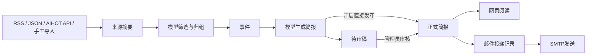

# 架构与边界

一个代码仓库、一个PostgreSQL数据库，两个应用进程：Web负责页面和短请求，Worker负责采集、模型处理、生成和邮件。二者调用同一份业务模块。初期运行单个Worker，串行处理资讯归组。

## 模块职责

- `collect`：读取RSS、JSON（含AIHOT API）或已适配HTML，校验时间、清理摘要、规范化链接并去重。保留AIHOT汇集归属、原始链接和分类；订阅缺少摘要时读取原页meta简介，不保存外部全文。
- `process`：给模型提供同一行业的近期候选事件，校验归组ID与栏目，事务更新事件及资讯状态。
- `briefs`：按统计区间与入选分筛选事件，调用模型生成结构化内容；来源链接由服务端附加，模型不能编造引用。
- `publication`：网页及邮件取得公开内容的统一读取入口，只返回已发布简报；资讯页返回已经处理的事件摘要。
- `subscriptions` / `mail`：登记、签名退订、名单与邮件发送。网页与邮件使用同一份结构化简报，分别渲染。
- `queue` / `worker`：持久化任务与定时检查，使用pg-boss，不另设消息中间件。

业务配置在数据库：行业、栏目、信源、自动发布、出刊时间、每日模型调用上限、选题范围。运行连接、密码、模型 API 地址、模型名与 Key和邮件凭据在环境变量；管理端只显示配置状态。

## 状态与一致性

每期由类型和出刊日期唯一标识。`draft`与`published`各保存一份内容快照；重新生成草稿不改动正式快照。审核发布在事务中替换正式内容并清空草稿。没有编辑器、历史版本浏览、多人协作或多级审批。

生成开始时读取自动发布开关。之后修改设置不会改变已经开始的任务，开启开关也不会批量发布旧草稿。

邮件投递仅在普通简报首次正式发布的同一数据库事务中创建，且须开启邮件服务。重新生成、重新发布只更新内容，即使旧投递记录已清理也不自动重发。补刊任务始终生成待审稿，持久化关闭该期自动推送，审核发布也不自动发邮件；补刊及修订版需在订阅管理手动选择发送。Worker仅处理已落库记录。投递记录约束同一期同一订阅者唯一；SMTP无法保证端到端恰好一次，发送不确定时保留状态并停止自动重发。

模型调用前在事务内登记回执并检查当天次数，所有请求共用环境变量 `LLM_BASE_URL`、`LLM_API_KEY` 指定的OpenAI兼容接口，管理端可分别选择处理、复核、简报模型，留空使用 `LLM_MODEL`；不增加供应商路由或Agent框架。后台任务失败可人工重试，不隐藏错误或生成占位简报。

## 当前范围与限制

- 信源格式为RSS/Atom、JSON和网页HTML；AIHOT API的JSON响应由内部字段解析处理，其他资料可以手工导入；不实现通用网页爬虫或付费网站登录。
- 归组召回最近14天内最多80个同业事件，按文本相似度选前12个候选；没有向量库。需要真实样本后再评估是否调整。
- 分数和选题提示词是初始规则，尚未用实际金融样本校准。
- 目前按事件最新材料时间选择区间，不提供历史时点的完整事件重放。
- 定时只检查当期，不自动追溯补刊。关闭采集、模型和邮件开关不会取消已在执行中的外部请求。
- 单个管理员，数据库保存随机会话令牌的哈希；后台页面和每个写操作分别验证会话。
- 仅回执、任务状态和发送结果用于定位运行问题，没有产品层面的测评、审计或反馈系统。
- 正式邮件服务尚未启用。真实信源接入与模型请求状态可在管理端检查。

## 阅读版式与期号

刊名为 Fin&AI简报，主内容标题使用本期主题。目录按行业下的栏目导航，链接定位该栏目的第一条资讯。侧栏和正文共用本期AI生成的主题标题，上限由`briefTitleMaxLength`配置（默认36字，含标点，允许1至200字）；超出在生成入口拒绝写入，不通过截断改变主题。旧的头条事件标记已从快照移除。

日报、周报按出刊年月折叠，只有当月默认展开；月报按统计月份所属年份分组，侧栏保留历年正式刊期。网页与邮件统一采用系统无衬线字体栈：system-ui、-apple-system、BlinkMacSystemFont、Segoe UI、PingFang SC、Hiragino Sans GB、HarmonyOS Sans SC、Microsoft YaHei、sans-serif；刊头大数字保留Arial Black粗体。侧栏日期块与两行本期标题按中线对齐，行业概览不显示“总览”标题与左侧边框。窄屏出刊日期使用普通完整日期文本；宽屏出刊信息居中排成“年月、点阵大日期、星期、期号”；打印入口贴在内容区右上边缘，总览不再标注简报类型。侧栏本期标题最多展示两行。期号按简报类型、年度分别累计，在首次正式发布的事务中分配；修订保留期号，暂未设置总期号。

2026年10月22日首期内容来自视觉稿HTML内的人工选读快照，保留原始来源与事实边界。仅标日期的来源单独保存日期精度，对外不显示推定的零点。

## 信源与栏目

AI按用户指定仅配置AIHOT、机器之心、新智元、量子位；金融采用已确认的央行、金融监管总局、证监会、上证报金融及银行保险报五家，不默认配置境外厂商信源；名单与实测结果见[信源说明](sources.md)。栏目在管理端配置，AI初始采用“AI 模型、AI 产品、行业动态、论文、教程、观点”。同一原文URL去重，同一事件再由模型归组；转载不等于独立验证，媒体传闻和厂商自述保留归属。

来源选定、运行开关开启后自动采集、处理及发布，保留人工审核开关。当前本机运行已指定的AI与金融来源。按信源配置的间隔检查，支持ETag、304与Retry-After，首次只读取最近7天，不镜像历史库。AIHOT仅读取API给出的摘要和链接，不请求境外原页；国内域名或中文网站不等于已验证部署网络可达，需在实际部署网络测试。每次付费请求仍受每日次数上限保护。

7×24资讯不使用简报归档侧栏。客户端开关控制SSE，隐藏页签暂停连接，恢复时按持久游标补齐。服务端连接每2秒读取变更表，有新内容先提示，用户点击才合并并返回列表顶部；手动刷新和分页保留行业与搜索条件，读取过程不调用模型。来源展示仅使用原始来源，内部汇集路径不作为公开标签。

迁移0006移除草稿和正式快照中已停用的 `leadEventId`，不修改正文与来源；0007扩充HTML格式，仅适配已指定的新智元官方列表。

金融适配集中在 `finance-sources.ts`，只涵盖已确认的五家来源。上证报从金融频道发现文章并使用其官方移动端公开内容API读取详情，银行保险报使用公开站点POST接口。所有HTTP请求仍经 `fetchSource` 的地址验证、限量解压和限流处理；跨站跳转不转发额外请求头。请求方法和公开站点标识仅由服务端适配定义，不加入管理端品牌格式。

模型配置更新：原 `DEEPSEEK_API_KEY` 改为 `LLM_API_KEY`，同时配置 `LLM_BASE_URL` 和 `LLM_MODEL`。原 `MODEL_DAILY_LIMIT` 改由管理端出刊设置保存，原有部署升级前需将自定义上限填入管理端；未配置时默认100次。既有调用回执保留，不重置当日用量。

## 任务与请求的一致性

`processing_steps`使用资讯输入/规则/模型的版本键记录独立程序步骤；成功结果可复用，失败和预算等待分开。综合模型步骤一次返回相关性、评分依据、结构化事实、来源原文片段、中文写作、归组和新增性。程序校验栏目、候选事件ID及原文片段；这些校验不等于对自然语言事实的完整验证。条件复核不通过时保存独立、低分、原文摘要事件及待核对说明。

`model_calls`在请求前事务锁保护下检查每日次数，按模型、提示词和输入指纹复用已校验成功响应。输入或提示词变化会产生新键。失败清除请求键，模型任务通过队列自动重试最多3次（60秒起指数退避），无人工核对放行流程；请求发送中最多占用5分钟，超时中断后自动恢复。金额估算、价格、币种设置和独立模型页已移除。输入、输出及token直接关联资讯时间线。

`event_developments`保留周期内新增事实，重复报道不重写事件；`news_changes`与事件更新同事务写入，使用事务锁使变更序号与提交顺序一致，避免断线游标跳过晚提交的数据。SSE、快照、分页均从publication读取层对外提供。

`source_hosts`在实际网络请求前按主机预约请求时间，详情和重定向同样经过它；429设置共享暂停。`collection_runs`保留信源快照及错误。自动调频只在每源上下限内渐变；有效的服务端Retry-After可以超过正常最大间隔，以服务端限制为准。

出刊规则由设置中的`weeklyDay`（0为周日，默认1）及`monthlyDay`（1至31，默认1）决定，定时、手动生成和补刊共用日期判断。月报出刊日超过当月天数时压到月末；统计起点为上个月同一计划规则得到的时刻，终点为本次计划时刻，连续月份不留缺口。新增字段保存在原settings JSON中，旧配置通过默认值承接，无须新增库表。修改规则影响之后的生成，不重算或补发历史。

管理台将原始资讯与处理任务合并为`/admin/articles`。表格展示时间、资讯和来源、阶段、状态；原生dialog承载摘要、处理阶段和重试入口。采集及出刊队列保留在页内单独区域；旧`/admin/jobs`地址跳转至统一页。弹窗支持键盘、Esc关闭和关闭后焦点返回。

金融写作约束在简报提示词和返回结果两处执行：摘要最多140字，概览最多120字；AI正文不应用此限制。

简报中心不再以版式示例替代未出刊类型；所有刊型切换仅查询正式发布快照，旧sample参数不生效。

## 周报复盘

新生成周报使用 `weekly-review-v1` 快照。按统计区间内的 `event_developments` 选取事件，不使用事件当前的最新日期判断历史刊期；新增进展同时保存当时的标题、摘要、栏目及评分，历史刊期优先使用当期记录。迁移前没有编辑快照的材料仅能沿用现存栏目和评分，不能还原当时评分。生成输入不包含事件当前标题和摘要，只含截止前的本周事实、报道及至多两条前情；重复报道保留为来源。

模型返回综合摘要及可选的连续进展列表。日期由引用材料的报道日期生成，不声称为实际发生日期；校验进展必须属于该事件及统计周，不能复用同一材料拆分节点，完全重复事实不能增加节点，依据摘录须存在于来源摘要。进展文字仍需审核，引用合法不等于完成语义核实。每条进展的日期、文字、来源URL与原始事实、摘录和事实状态随简报归档，资讯及过程数据清理不影响历史刊阅读。通用编辑要求继续共用，周报结构和取材约束单独执行。

网页和邮件按行业、栏目单栏排布：事件标题、综合摘要、有至少两次实质变化时的本周进展、来源。进展可查看对应摘录；邮件提供原始依据链接。新版取消全刊“一周进程”，已有周报和月报保留既有版式；重新生成的周报使用新版，发布修订不自动推送。
