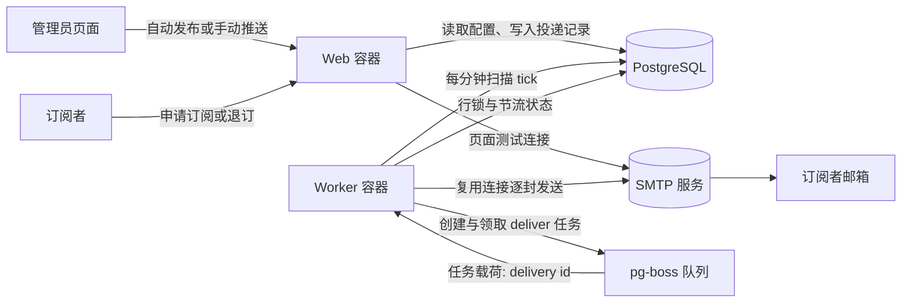
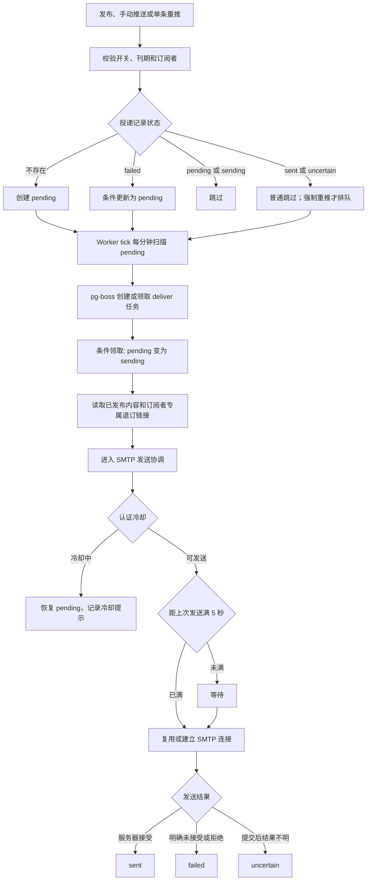

# 邮件推送：流程、状态与运行方案

本文记录日报邮件、订阅确认信及管理员手动重推的运行方式，用于排查投递延迟、认证失败、重复发送和连接复用问题。模型调用与队列重试的通用规则见[模型主备切换与任务重试](model-runtime.md)。

## 目标与边界

邮件推送需要同时满足四项约束：

1. 每封日报只向一个订阅者投递，正文含该订阅者专属的退订链接。
2. 同一封日报与订阅者的组合只能存在一条投递记录；手动与自动推送共用去重规则。
3. 明确失败、已发送和结果不明的邮件不会由队列自动重发。
4. 对同一 SMTP 账号控制连接与认证频率，同时允许不同收件人的邮件正文不同。

页面上的“群发”指一次选择多个订阅者，实际仍为逐封发送。这样不需要 BCC 共享退订链接，也不会向一个收件人暴露其他地址。

## 系统组件

Web 只创建投递记录，不等待实际发送完成。Worker 常驻运行，同时承担采集、模型处理、出刊、邮件投递与清理；邮件发送不依赖管理员页面保持打开。

## 三类入口

### 自动投递

日报首次发布时，Web 在发布事务中调用投递出箱逻辑。仅当以下条件同时成立时，才为订阅者创建 `pending` 记录：

- 刊期类型为 `daily`。
- 该刊期此前尚未正式发布。
- 刊期允许自动投递，即不是补刊。
- 页面推送总开关已开启。
- 订阅者处于有效状态，且订阅类型包含 `daily`。

投递记录与发布在同一事务提交，因此发布成功但出箱记录未写入的中间状态不会出现。关闭推送时发布日报不会补建投递；以后重新开启也不会补发此前关闭期间的刊期。普通修订保留原期号与发布时间，不重新创建投递。

### 管理员手动推送

管理员选择一个已发布刊期和一批有效订阅者。系统先在事务内校验推送开关、刊期和订阅者，再通过 `(brief_id, subscription_id)` 唯一约束去重：

- 没有记录：创建 `pending`。
- 已为 `failed`：重新设为 `pending`。
- 已为 `pending` 或 `sending`：跳过。
- 已为 `sent` 或 `uncertain`：普通推送跳过；勾选强制重推时才重排。

所有邮箱必须先通过校验，否则整批操作失败，不会只排入其中一部分。提交后，记录由 Worker 的每分钟扫描发现，而不是由页面直接连接 SMTP。

### 单条重新推送

推送记录页每页显示 50 条，并按投递时间倒序排列；同一时间使用投递 ID 进行稳定排序。只有 `failed` 记录显示“重新推送”操作：

1. 服务端再次检查管理员会话。
2. 校验投递 ID 确实存在且当前仍为 `failed`。
3. 以原刊期和原订阅者调用统一的手动推送入口。
4. 推送开关关闭、SMTP 配置不完整或订阅者已退订时拒绝重排。
5. 并发点击同一记录时，条件更新只允许一次从 `failed` 变为 `pending`。

操作完成后返回原分页，并显示“已重新加入发送队列”。按钮进入排队状态不代表邮件已经送达；最终结果仍以推送记录的状态为准。

## 完整投递链路

## 队列与 Worker 调度

邮件任务名为 `deliver`，载荷只包含投递记录 ID。Worker 使用该 ID 从数据库重新读取当前内容、收件人和配置，避免把完整正文和敏感信息放进队列。

Worker 的定时 `tick` 每分钟运行，最多扫描 100 条 `pending` 记录，并为每条记录创建以投递 ID 为单例键的队列任务。已有未完成的同 ID 任务不会被重复创建。

`deliver` 队列的自动重试次数为 0，与采集、处理、出刊任务不同。邮件由投递状态和去重约束控制恢复，不能依赖队列自动重放。页面点击后的等待通常来自：

- 等待下一次每分钟扫描。
- Worker 当前正在发送上一封邮件。
- 5 秒发送节流。
- 认证失败后的 15 分钟冷却。
- 连接、问候或套接字超时。

Worker 停止时，`pending` 记录仍保存在数据库中；Worker 恢复后会继续扫描。已经明确失败的记录不会因 Worker 重启而自动恢复。

## 状态机

| 状态        | 含义                                 | 自动发送 | 页面操作                           |
| ----------- | ------------------------------------ | -------- | ---------------------------------- |
| `pending`   | 等待 Worker 处理，或在冷却中稍后继续 | 是       | 不显示重推                         |
| `sending`   | 已被一个执行者领取，避免并发重复发送 | 否       | 不显示重推                         |
| `sent`      | SMTP 服务已接受邮件                  | 否       | 普通推送跳过；可强制重推           |
| `failed`    | 可确认邮件未被接受或被明确拒收       | 否       | 显示“重新推送”                     |
| `uncertain` | 正文可能已提交，但没有明确回执       | 否       | 不显示重推；可在手动推送中强制重推 |

发送前使用条件更新将 `pending` 改为 `sending`。只有成功领取的 Worker 才能继续，因此重复扫描、多个任务或管理员连续点击都不会让同一记录并行发送。

“结果不明”通常发生在正文提交后连接中断、等待服务器最终回执超时等场景。此时自动重发有造成重复邮件的风险，所以保留 `uncertain` 供管理员核对。

## SMTP 连接复用

日报与订阅确认信使用同一个发送协调器。连接池按 SMTP 配置缓存，配置键包含：

- SMTP 地址和端口。
- 加密方式。
- 登录账号和授权码。
- 发件人字段不参与缓存键；地址、端口、加密方式、账号或授权码变化时会使用新连接。

连接池设置如下：

| 参数         | 当前值 | 作用                                       |
| ------------ | -----: | ------------------------------------------ |
| 最大连接数   |      1 | 同一发送池同一时间只有一个 SMTP 连接       |
| 单连接消息数 |    100 | 连续发送 100 封后重新建连认证              |
| 空闲关闭     |  60 秒 | 空闲超过一分钟关闭连接，避免使用已失效连接 |
| 断线重排     |      0 | 连接池不自行重发结果不明的邮件             |

同一 Worker 中的连续投递会优先复用现有 TCP/TLS 连接，不重复执行登录认证。每封邮件仍独立生成正文和专属退订链接。

在单 Worker 部署下，连续任务通常复用同一连接。以后增加多个 Worker 时，数据库节流仍会阻止同一账号同时发送，但 TCP 连接不能跨进程共享，因此不同 Worker 可能各自认证一次。

## 发送节流与数据库锁

迁移 `0038_mail_send_runtime.sql` 新增 `mail_send_runtime`：

| 字段             | 含义                           |
| ---------------- | ------------------------------ |
| `connection_key` | SMTP 配置的 SHA-256 缓存键     |
| `next_send_at`   | 同一配置下次允许开始发送的时间 |
| `cooldown_until` | 认证冷却截止时间               |

发送协调器在一个 PostgreSQL 事务中锁定该配置对应的行，并完成以下步骤：

1. 检查认证冷却是否仍然有效。
2. 计算距 `next_send_at` 的剩余时间。
3. 需要时等待，再执行一次 SMTP 发送。
4. 更新下次发送时间；认证失败时同时写入冷却截止时间。
5. 提交状态后再向投递业务返回结果。

一次发送尝试结束后，同一配置的下一次发送至少等待 5 秒才开始。Web、Worker 或多个进程通过行锁共享同一节流状态，不会各自按内存计时器并发发送。

SMTP 连接测试使用独立连接，只执行连接和认证，不发送邮件，也不修改 `mail_send_runtime`。因此连接测试成功只能说明当时的地址、端口、加密方式和账号可用，不能证明生产批量发送不会触发限频。

## 认证失败与冷却

当 SMTP 服务返回 `535`、`EAUTH` 或其他明确认证错误时：

1. 当前投递标记为 `failed`，保留脱敏后的错误原因。
2. 关闭当前 SMTP 连接。
3. 将同一配置的 `cooldown_until` 设为 15 分钟后。
4. 尚未发送的投递保持 `pending`，Worker 后续扫描时只检查冷却状态，不继续认证。
5. 冷却结束后，仍为 `pending` 的投递继续自动处理。
6. 已经明确失败的第一封邮件仍需在推送记录页重新推送。

冷却保存在数据库中，Worker 重启、连接池重建或页面刷新都不会清除。修改 SMTP 地址、端口、加密方式、账号或授权码后会形成新的配置键，因此不会沿用旧配置的冷却。

## 错误分类与脱敏

连接前或投递信封阶段失败，以及服务器明确返回 4xx/5xx 拒收时，记录为 `failed`。正文提交后的断线、最终回执超时等无法确认服务器是否接受的情况，记录为 `uncertain`。

Nodemailer 有时会把正文提交后的断线也标记为 `CONN`，因此不能仅凭 `CONN` 认定尚未提交。错误分类还会检查底层错误码和超时阶段。

写入页面前的错误原因会删除：

- SMTP 密码和授权码。
- 密码的 Base64 与 URL 编码形式。
- 邮箱地址。
- 服务返回的错误链接。

## 推送记录与人工重推

推送记录展示邮箱、刊期、创建时间、状态、错误原因和操作。每页 50 条，显示总条数和页码。

操作规则：

| 页面状态        | 操作           |
| --------------- | -------------- |
| 发送失败        | 可单条重新推送 |
| 待发送、发送中  | 无重推操作     |
| 已发送          | 无单条重推操作 |
| 结果待确认      | 无单条重推操作 |
| 账户已退订      | 重推按钮禁用   |
| 推送总开关关闭  | 重推按钮禁用   |
| SMTP 配置不完整 | 重推按钮禁用   |

“手动推送”页面仍提供“重新推送已发送或结果待确认的邮件”选项，用于管理员核对后显式强制重推。单条操作只面向可以安全重排的 `failed` 记录。

## 数据与清理

投递记录以刊期和订阅者组合唯一。邮件投递记录按系统设置中的邮件保留天数滚动清理；未结束的投递不会被正常清理流程删除。

冷却与节流表不保存正文、邮箱或授权码，只保存配置哈希、时间与冷却状态。该表不随普通连接关闭而删除，冷却需要跨进程和重启保持有效。

## 排查顺序

1. 查看推送记录的状态和错误原因，确认是 `failed`、`uncertain` 还是长期 `pending`。
2. 在推送配置页测试连接。测试通过但批量仍失败时，优先考虑登录频率、账号风控或发送额度。
3. 检查 Worker 容器健康、数据库连接和 Worker 心跳。
4. 检查推送总开关、SMTP 配置、订阅者状态和刊期是否正式发布。
5. 若记录长期 `pending`，确认 Worker 的每分钟 `tick` 是否运行，以及是否仍处于认证冷却期。
6. 若记录为 `uncertain`，先核对 SMTP 服务商或发件箱记录，避免直接造成重复投递。
7. 修复 SMTP 配置后，等待冷却结束并重新推送 `failed` 记录；`pending` 记录会由 Worker 继续处理。

## 实现与测试入口

- 发布与投递出箱：`src/server/briefs.ts`、`src/server/delivery-outbox.ts`。
- 手动推送、单条重推与去重：`src/server/manual-delivery.ts`。
- 推送记录分页：`src/server/delivery-history.ts`。
- Worker 调度与队列：`src/worker.ts`、`src/server/queue.ts`。
- 投递状态与正文：`src/server/mail.ts`。
- 节流、冷却与连接缓存：`src/server/mail-sender.ts`。
- SMTP 连接参数：`src/server/mail-transport.ts`。
- 错误分类和脱敏：`src/server/mail-errors.ts`。
- 业务回归：`tests/mail-delivery.test.ts`、`tests/mail-transport.test.ts`、`tests/manual-delivery.test.ts`。
- 页面回归：`tests/browser/delivery-history.spec.ts`。
